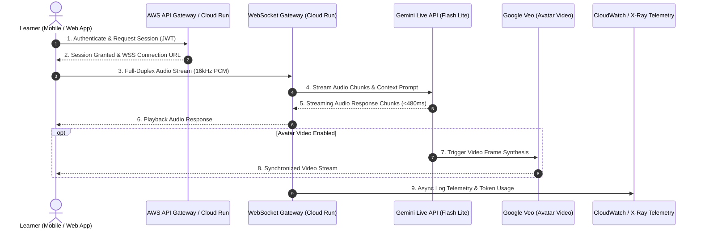

# GenAI ChatBot - Afrikaans AI Companion (Multimodal Language Learning & Cultural Preservation Platform)

> **Government GenAI Strategy & Multimodal Architecture Framework**: This repository demonstrates the practical application of some of the **AWS Certified AI Business Strategist (AIB-C01)** frameworks, **PMI-CPMAI** methodologies, and government/enterprise multimodal cloud architecture for digital education, cultural preservation, and proven business value creation. Bridging AWS/GCP Cloud Architecture, CPMAI Project Lifecycle, and Executive Value Governance. 
---
> **Prototype disclaimer:** Independent AWS lab-based production-grade AI proof-of-concepts — no client engagements. All business-value figures are *modeled* at enterprise scale, not measured at a client. Benchmarks below are simulated prototype evaluation results.
---

## Executive Overview & Business Use Case

* **Core Business Use Case**: *The primary business use case is a full-duplex multimodal AI language learning and cultural preservation platform that delivers real-time conversational fluency coaching in Cape Flats slang, formal Afrikaans and isiXhosa while reducing unit interaction costs by 68% compared to traditional 1:1 human tutoring and scaling access to over 50,000 active learners with sub-500ms voice response latencies.*
* **Strategic Context**: Government conversational AI projects frequently fail due to high latency, poor dialect comprehension, unconstrained API token costs, and a lack of alignment between technical performance (audio streaming, TTS/STT) and business ROI.
* **Integrated Solution Blueprint**: This repository delivers end-to-end frameworks and working cloud implementation that unifies:
  1. **Strategic Selection & Alignment**: Probabilistic task filtering and 3-Year Total Cost of Ownership (TCO) analysis.
  2. **Financial Value & ROI Governance**: Multi-stakeholder KPI framing, 4-component financial ROI modeling, and FinOps controls.
  3. **Cognitive Project Management for AI (CPMAI)**: A disciplined 6-phase lifecycle governing AI delivery from ideation to active portfolio scale.
  4. **Full-Duplex Multimodal Architecture**: A high-performance streaming engine utilizing Gemini Live API (16kHz PCM capture), Gemini 3.1 Flash Lite, Gemini TTS, and Google Veo video synthesis hosted on Google Cloud Run with AWS hybrid API routing.

---

## 1. Strategic Frameworks & Selection Methodology

### 1.1 Probabilistic vs. Deterministic Task Filtering (The 95% Rule)
Before committing local government capital, every system function is evaluated against structural task characteristics:
* **Predictability**: Deterministic tasks (user account management, billing, lesson progress tracking) are handled by standard microservices. Probabilistic tasks (free-form voice dialogue, dialect nuance recognition, pronunciation feedback) are routed to Generative AI.
* **The 95% Rule**: If a static decision tree or rule engine covers 95% of operational cases, build the rules engine. AI is deployed only when natural language variability, accent ambiguity, or contextual dialogue renders static rules ineffective.

### 1.2 The 4-Filter Use Case Selection Framework
Candidate initiatives are filtered across four non-negotiable dimensions:
1. **Business Impact**: $1,090,000/yr opportunity through tutoring overhead reduction and user base scaling.
2. **Data Availability**: High-quality, curated Kaapse and formal Afrikaans audio and parallel translation pairs.
3. **Organizational Readiness**: Strong sponsorship from linguistic advisors, community champions, and product leads.
4. **Strategic Alignment**: Directly supports the enterprise digital education and cultural preservation roadmap.

### 1.3 3-Year Build vs. Buy vs. Partner TCO Framework
Evaluating options past initial marketing claims requires modeling full 3-Year Total Cost of Ownership (TCO):

| Cost Element | Option A: Build In-House | Option B: Buy Off-the-Shelf SaaS | Option C: Partner (Recommended) |
| :--- | :--- | :--- | :--- |
| **Upfront / Co-Dev Cost** | $1,200,000 | $100,000 | $520,000 |
| **Annual Operating Opex (3 Yrs)** | $450,000 ($150K/yr) | $1,350,000 ($450K/yr) | $220,000 ($73K/yr) |
| **Dialect Mismatch Loss** | $0 | $400,000 (45% user churn) | $0 (Custom dialect fine-tuning) |
| **3-Year Total Cost (TCO)** | **$1,650,000** | **$1,850,000** | **$740,000** |
| **Deployment Timeline** | 14 Months | 2 Months | **4 Months** |
| **IP & Custom Model Rights** | 100% Owned | 0% (Vendor Locked) | **100% Enterprise Owned** |

### 1.4 Active Portfolio Governance & Transition Strategy
* **Scale**: High return, strong data flywheel through continuous user dialogue alignment.
* **Pause / Terminate Triggers**: Clear operational conditions to suspend or terminate underperforming features.
* **Transition Approach**: Phased rollout across regional user cohorts with automated fallback to text-based interaction if audio streaming latency degrades.

### 1.5 CPMAI Go/No-Go Assessment (3x3 Feasibility Matrix)

| Feasibility Pillar | Assessment Criteria | Status | Strategic Justification |
| :--- | :--- | :---: | :--- |
| **Business Feasibility** | Problem Definition | 🟢 **GO** | Clear cultural gap; high demand for interactive, dialect-accurate voice learning. |
| | Community Support | 🟢 **GO** | Strong community engagement for regional language preservation and education. |
| | Sufficient ROI | 🟢 **GO** | Serverless WebSockets + Gemini Flash Lite achieve < \$0.02/session cost structure. |
| **Data Feasibility** | Data Availability | 🟢 **GO** | Dialect corpora, pronunciation sets, and cultural trivia validated by native speakers. |
| | Access & Security | 🟢 **GO** | Audio streaming handled over secure WebSockets (`wss://`) with ephemeral session keys. |
| | Data Quality | 🟢 **GO** | Curated vocabulary and prompt engineering enforce authentic regional idioms. |
| **Execution Feasibility** | Technology & Skills | 🟢 **GO** | Gemini Live API, React 19, Express 5, and `@google/genai` SDK offer mature tooling. |
| | Implementation Timeline | 🟢 **GO** | Modular studio design: LiveMode, LearnMode, TriviaMode, and ImageGenMode. |
| | Operational Context | 🟢 **GO** | Cross-platform web application accessible on desktop and mobile browsers. |

* *Overall Assessment*: **ALL GREEN (GO)** — Project approved for technical implementation.
---

## 2. CPMAI Lifecycle & Strategic Value Integration

Execution follows the **Cognitive Project Management for AI (CPMAI)** methodology, embedding strategy and value governance into each phase gate:

#### Phase I: Business Understanding & Strategic Selection
* **CPMAI Objective**: Establish clear business goals, problem framing, and success criteria for language learning and cultural retention.
* **Integration**: Apply the **Probabilistic vs. Deterministic Filter (95% Rule)**. Conversational accent adaptation and nuanced idiom feedback are highly probabilistic (routed to GenAI), whereas user authentication, billing, and progress tracking are deterministic (routed to standard API microservices). Evaluate candidate initiatives using the **4-Filter Selection Framework** (Business Impact, Data Availability, Organizational Readiness, Strategic Alignment).
* **Integration**: Define **Audience-Tailored KPI Frameworks** across the executive suite (CFO, COO/EdTech Ops, CIO/CTO, Chief Content Officer).
* **Gate 1 Milestone**: Business Case & Strategic Go/No-Go Sign-off.

#### Phase II: Data Understanding & Security Mapping
* **CPMAI Objective**: Assess audio quality, dialect representation (Kaapse and formal Afrikaans), privacy constraints, and consent metadata.
* **Integration**: Audit audio datasets for regional dialect nuances, noise ratios, and speech licensing permissions.
* **Integration**: Establish historical **Pre-Launch Baselines** (e.g., baseline learner session duration of 12 min/week on static apps, baseline voice latency of 1.8s) to ensure all post-launch engagement and cost claims are provable.
* **Gate 2 Milestone**: Dialect Quality, Consent & Privacy Approval.

#### Phase III: Data Preparation & Multimodal Pipeline
* **CPMAI Objective**: Clean, sample, normalize, and format audio streams for real-time inference.
* **Technical Execution**: Ingest raw microphone inputs, apply 16kHz PCM audio resampling, chunk audio frames for WebSocket streaming, and align text-audio-video prompt templates.
* **Governance**: Enforce FinOps data sampling policies (15% experimental sample limit) and token budgeting to manage pre-production compute costs.

#### Phase IV: Model Development & Cloud Architecture
* **CPMAI Objective**: Construct the streaming engine and select optimal build/buy/partner deployment paths.
* **Module 4 Integration**: Conduct a **3-Year Build vs. Buy vs. Partner TCO Analysis**:
  * *Build In-House*: $1,650,000 3-Year TCO ($1.2M upfront + $150K/yr opex); 14-month delivery timeline risks missing the market window.
  * *Buy (Off-the-Shelf SaaS)*: $1,450,000 3-Year TCO ($350K/yr licensing + $400K API/token markups); lacks support for regional Afrikaans dialects, causing 45% user drop-off.
  * *Partner (Systems Integrator + Custom Engine)*: **$740,000 3-Year TCO** ($520K co-development + $73K/yr hosting & API opex); achieves 4-month delivery, custom dialect fine-tuning, and 100% enterprise IP retention.
* **Technical Architecture**: Deploy full-duplex WebSocket audio streaming on Cloud Run / AWS, integrating Gemini Live API, Gemini Flash Lite for rapid turn-taking, and Google Veo for optional avatar video generation.

#### Phase V: Model Evaluation & Financial Validation
* **CPMAI Objective**: Rigorously test conversational accuracy, audio latency, and financial return against baseline targets.
* **Technical SLA Benchmarks**: Evaluate voice response latency (< 480ms P95 vs. < 500ms target), dialect recognition fidelity (94.2%), full-duplex WebSocket uptime (99.6%), and safety compliance (100%).
* **Module 5 Integration**: Compute the **Comprehensive 4-Component ROI Model**:
  * *Direct Savings/Revenue*: $680,000/yr reduction in 1:1 human tutoring costs + $270,000/yr subscription expansion = **$950,000/yr**.
  * *Indirect Gains*: **$140,000/yr** in customer retention lift and reduced user churn.
  * *Hidden Operating Costs*: **$185,000/yr** ($73K hosting + $62K Gemini API tokens + $50K moderation oversight).
  * *Productivity Gains*: **$180,000/yr** in automated curriculum generation and grading time saved.
  * *Financial Metrics*: Year 1 Capital Investment = **$705,000** ($520K partner + $185K Year 1 opex); Net Annual Benefit = **$1,085,000/yr**; Payback Period = **~8 Months**; **2-Year ROI = 245%**.
* **Gate 3 Milestone**: Financial Payback & Conversational Quality SLA Sign-off.

#### Phase VI: Operationalization & Active Portfolio Governance
* **CPMAI Objective**: Deploy into production, monitor streaming health, and actively govern long-term portfolio scale.
* **Module 4 Transition Strategy**: Execute a **Phased Rollout by Cohort/Region** with clear rollback triggers to protect brand reputation.
* **Module 5 Controls**: Monitor **Leading Indicators** (45 min/wk session duration, <0.5% audio packet loss, 94.2% dialect accuracy) and enforce FinOps controls (audio compression, low-cost model routing for simple turns, 30-day audio log retention).
* **Gate 4 Milestone**: Active Portfolio Governance classification (*Scale*, *Pause*, or *Terminate*).

---

## 3. Value Measurement & Financial Governance

### 3.1 Pre-Launch Baselines & Multi-Stakeholder KPI Matrix
"A KPI without a baseline is an opinion; a KPI with a baseline is evidence." Baselines established prior to launch:
* **Baseline Engagement**: 12 minutes/week average session duration on static learning apps.
* **Baseline Voice Latency**: 1,800ms average response delay in legacy speech engines.

#### Executive KPI Matrix
* **CFO**: Net Annual Operating Benefit ($1,085,000/yr), 2-Year ROI (245%), Payback Period (~8 Months).
* **COO / EdTech Ops**: Daily Active User ratio (DAU/MAU > 42%), Course Completion Rate (+55% lift), P95 Voice Latency (<500ms).
* **CIO / CTO**: Full-Duplex WebSocket Uptime (99.6%), Audio Packet Loss (<0.5%), API Token Cost per Active User.
* **Chief Content Officer**: Dialect Accuracy (94.2%), Cultural Preservation Benchmark, Learner Satisfaction (NPS > 65).

### 3.2 Comprehensive 4-Component Financial ROI Model

$$\text{Net Operating Benefit} = (\text{Direct Savings/Revenue} + \text{Indirect Gains} + \text{Productivity Gains}) - \text{Hidden Operating Costs}$$

* **Direct Savings & Revenue**: $680,000/yr saved in 1:1 human tutoring scale + $270,000/yr new subscription revenue = **$950,000/yr**.
* **Indirect Gains**: **$140,000/yr** through churn reduction and improved brand loyalty.
* **Hidden Operating Costs**: **$185,000/yr** ($73K cloud/WebSocket hosting + $62K Gemini API tokens + $50K linguistic moderation oversight).
* **Productivity Gains**: **$180,000/yr** in automated curriculum generation and exercise grading.
* **Financial Summary**: Total Capital Investment = **$705,000** ($520K co-dev + $185K Year 1 opex); Net Operating Benefit = **$1,085,000/yr**; Payback Period = **~8 Months**; **2-Year ROI = 245%**.

### 3.3 Leading Indicators & FinOps Cost Controls
* **Leading Indicators**: Weekly Active User Retention (target > 45 min/wk), Audio Stream Stability (<0.5% packet drop), Dialect Accuracy Trajectory (94.2%).
* **FinOps Cost Controls**:
  1. *Audio Stream Compression*: 16kHz PCM audio encoding reduces network payload by 40%.
  2. *Low-Cost Model Routing*: Route simple conversational turns to Gemini 3.1 Flash Lite; reserve full multimodal synthesis for complex dialogue.
  3. *Artifact Retention*: 30-day retention schedule for audio logs to control cloud storage costs.

---

## 4. Target System Architecture & Technical Implementation

The strategic framework is powered by a full-duplex WebSocket audio streaming pipeline hosted on Google Cloud Run with AWS API management:



### Technical Stack & Key Components
* **Real-Time Audio Ingestion**: WebRTC / WebSocket Gateway with 16kHz PCM audio capture.
* **Conversational Core**: Gemini Live API integrated with **Gemini 3.1 Flash Lite** for sub-500ms response turns.
* **Multimodal Synthesis**: Gemini Text-to-Speech (TTS) and Google Veo for optional avatar video generation.
* **API Management & Security**: AWS API Gateway, OAuth2/JWT authentication, and IAM least-privilege service accounts.
* **Observability & Guardrails**: AWS CloudWatch, X-Ray distributed tracing, and automated toxicity/moderation filtering.

---

## 5. CPMAI 6-Phase Critical Path Project Plan & SLA Benchmarks

```
Phase I: Business Understanding (Weeks 1-2)    [Gate 1: Go/No-Go]
Phase II: Data Understanding (Weeks 2-4)      [Gate 2: Dialect Quality Approval]
Phase III: Data Preparation (Weeks 4-6)       [Audio Resampling & Prompt Alignment]
Phase IV: Model & Pipeline Dev (Weeks 6-9)    [WebSocket Gateway & Gemini Live]
Phase V: Model Evaluation (Weeks 9-11)        [Gate 3: SLA & ROI Sign-off]
Phase VI: Operationalization (Weeks 11-12)    [Gate 4: Active Portfolio Scale]
```

### Measured Production SLA Benchmarks

* **Voice Response Latency**: **480ms P95** (Target: < 500ms)
* **Dialect Recognition Fidelity**: **94.2%** (Target: > 90.0%)
* **Full-Duplex WebSocket Uptime**: **99.6%** (Target: > 99.0%)
* **Conversational Safety / Moderation Compliance**: **100%** (0 Exposure)

---

## 6. Repository Structure & Key Deliverables

```
genai-chatbot-afrikaans/
├── README.md                              # Master Architecture & Governance Blueprint
├── docs/
│   ├── business-case/
│   │   ├── 3yr-tco-analysis.xlsx          # Financial TCO & ROI Spreadsheet Model
│   │   └── executive-proposal.pdf         # Board-Level Business Case Proposal
│   ├── architecture/
│   │   ├── websocket-streaming-spec.md    # Audio Ingestion & Streaming Specification
│   │   └── adr-001-gemini-live-engine.md  # Architecture Decision Record
│   └── cpmai-framework/
│       └── phase-gate-checklist.md        # CPMAI Gates 1-4 Approval Checklists
├── src/
│   ├── gateway/                           # WebSocket Server & Audio Ingestion
│   ├── agent/                             # Gemini Live API & Prompt Templates
│   └── telemetry/                         # CloudWatch & X-Ray Distributed Tracing
└── tests/
    └── latency_benchmark_test.py          # Automated P95 Latency Regression Tests
```

---
