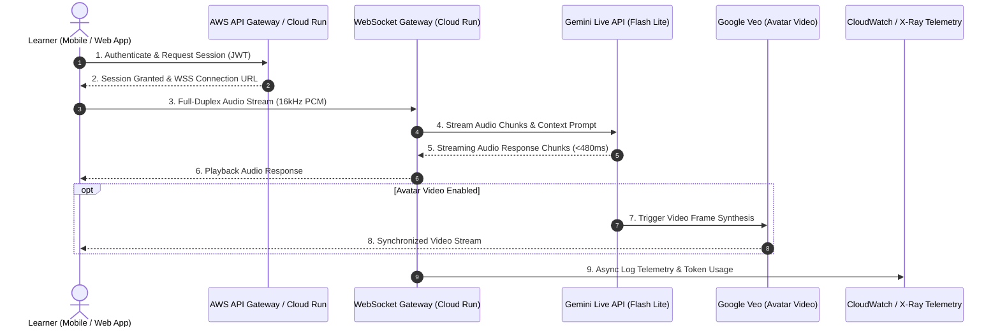

## GenAI ChatBot — Afrikaans AI Companion (Multimodal Language Learning & Cultural Preservation Platform)

> **EdTech GenAI Strategy & Multimodal Architecture**: This repository demonstrates the practical application of the **PMI-CPMAI** framework and the **AWS AI Business Strategist (AIB-C01 — in progress)** methodology for AI strategy, delivery governance, and value demonstration in digital education.

> **Prototype disclaimer:** Independent lab-based production-grade AI proof-of-concept — no client engagements. All business-value figures are *modeled* at enterprise scale, not measured at a client. Benchmarks below are simulated prototype evaluation results.

---

## Executive Overview & Business Use Case

- **Core Use Case**: A full-duplex multimodal AI language-learning and cultural-preservation platform delivering real-time conversational fluency coaching in Cape Flats slang (Kaapse Afrikaans), formal Afrikaans, and isiXhosa — modeled to cut per-session interaction cost by 68% versus 1:1 human tutoring and scale to 50,000+ active learners at sub-500ms voice response latency.
- **Strategic Context**: Conversational AI initiatives in education fail less from model capability than from high latency, poor dialect comprehension, unconstrained API token costs, and missing alignment between technical performance and business ROI.
- **What This Repo Contains**: An end-to-end blueprint plus working prototype unifying:
  1. **Investment Strategy & Selection** (§1): probabilistic task filtering, 4-filter selection, CPMAI 3x3 feasibility, 3-year TCO.
  2. **CPMAI Delivery Lifecycle** (§2): 6-phase gated delivery applying the §1 strategy at each gate.
  3. **Value & Financial Governance** (§3): baselines, multi-stakeholder KPIs, 4-component ROI, FinOps controls.
  4. **Full-Duplex Multimodal Architecture** (§4): Gemini Live API (16kHz PCM), Gemini 3.1 Flash Lite, Gemini TTS, Google Veo video synthesis on Cloud Run.

---

## Live Demo

**Try the working prototype**: [Maralack Cape Flats AI Companion](https://maralack-afrikaans-ai-companion-1072691364189.us-east1.run.app/) — a deployed demo of the full-duplex voice companion described below, running on Cloud Run. Pick a topic (Greetings, Food & Dining, Travel, Numbers & Time, Common Verbs, isiXhosa Basics) and try a voice session.

*Demo runs the prototype build; see [Prototype Benchmarks](#5-build-plan--prototype-benchmarks) for evaluated performance.*

---

## 1. Investment Strategy & Selection

*This section states each framework once. The delivery lifecycle (§2) applies them at phase gates instead of re-defining them.*

### 1.1 Probabilistic vs. Deterministic Task Filtering (The 95% Rule)

- **Deterministic** (routed to standard microservices): user account management, billing, lesson progress tracking.
- **Probabilistic** (routed to GenAI): free-form voice dialogue, dialect nuance recognition, pronunciation feedback — where natural-language variability and accent ambiguity defeat static rules.

### 1.2 The 4-Filter Use-Case Selection

1. **Business Impact**: $1,090,000/yr modeled opportunity via tutoring-cost reduction and learner-base scaling.
2. **Data Availability**: curated Kaapse/formal Afrikaans audio corpora and parallel translation pairs.
3. **Organizational Readiness**: sponsorship from linguistic advisors, community champions, and product leads.
4. **Strategic Alignment**: supports the digital-education and cultural-preservation roadmap.

### 1.3 CPMAI 3x3 Go/No-Go Assessment

| Pillar | Criteria | Status | Justification |
| --- | --- | --- | --- |
| **Business** | Problem definition | 🟢 GO | Clear gap in dialect-accurate interactive voice learning |
| | Community support | 🟢 GO | Strong engagement for regional language preservation |
| | Sufficient ROI | 🟢 GO | Serverless WebSockets + Flash Lite → < $0.02/session modeled cost |
| **Data** | Availability | 🟢 GO | Dialect corpora and pronunciation sets validated by native speakers |
| | Access & security | 🟢 GO | `wss://` streaming with ephemeral session keys |
| | Quality | 🟢 GO | Curated vocabulary; prompt engineering enforces authentic idioms |
| **Execution** | Technology & skills | 🟢 GO | Gemini Live API, React 19, Express 5, `@google/genai` SDK |
| | Timeline | 🟢 GO | Modular modes: LiveMode, LearnMode, TriviaMode, ImageGenMode |
| | Operational fit | 🟢 GO | Cross-platform web app (desktop + mobile browsers) |

**Overall: ALL GREEN — approved for implementation (Gate 1).**

### 1.4 3-Year Build vs. Buy vs. Partner TCO (Modeled)

| Cost Element | Option A: Build In-House | Option B: Buy SaaS | Option C: Partner (Recommended) |
| --- | --- | --- | --- |
| **Upfront / Co-Dev** | $1,200,000 | $100,000 | $520,000 |
| **Annual Opex (3 Yrs)** | $450,000 ($150K/yr) | $1,350,000 ($450K/yr) | $220,000 ($73K/yr) |
| **Dialect Mismatch Loss** | $0 | $400,000 (45% churn — no Kaapse support) | $0 (custom dialect tuning) |
| **3-Year TCO** | **$1,650,000** | **$1,850,000** | **$740,000** |
| **Timeline** | 14 months | 2 months | **4 months** |
| **IP & Model Rights** | 100% owned | 0% (vendor-locked) | **100% retained** |

**Decision: Partner** — 4-month delivery, custom dialect support, lowest TCO, full IP retention.

---

## 2. CPMAI Delivery Lifecycle

*Each phase applies the §1 strategy at its gate; framework definitions are not repeated here.*

#### Phase I: Business Understanding
- Applied §1.1–§1.3 filters → **Gate 1 GO**. Defined audience-tailored KPIs (see §3.2).
- **Gate 1 Milestone**: Business Case & Go/No-Go Sign-off.

#### Phase II: Data Understanding & Security
- Audited audio datasets for dialect nuance, noise ratios, and speech-licensing consent. Captured pre-launch baselines (see §3.1).
- **Gate 2 Milestone**: Dialect Quality, Consent & Privacy Approval.

#### Phase III: Data Preparation & Multimodal Pipeline
- 16kHz PCM resampling, WebSocket audio-frame chunking, text-audio-video prompt alignment. FinOps: 15% experimental data sampling; token budgeting.
- **Milestone**: Streaming pipeline operational.

#### Phase IV: Model Development & Cloud Architecture
- Executed the §1.4 TCO decision → **Partner track**. Built the full-duplex WebSocket engine (see §4): Gemini Live API + Flash Lite turn-taking, Veo avatar video.
- **Milestone**: Staging deployment on Cloud Run.

#### Phase V: Model Evaluation & Financial Validation
- Ran prototype benchmarks (see §5) and the §3.3 ROI model against Gate 3 thresholds.
- **Gate 3 Milestone**: Financial Payback & Conversational Quality Sign-off.

#### Phase VI: Operationalization & Portfolio Governance
- Phased rollout by learner cohort/region with rollback triggers (fallback to text on audio degradation). Monitored via §3.4 leading indicators and FinOps controls.
- Portfolio classification: **Scale** / Pause / Terminate.
- **Gate 4 Milestone**: Active Portfolio Governance sign-off.

---

## 3. Value Measurement & Financial Governance (All Figures Modeled)

### 3.1 Pre-Launch Baselines

*"A KPI without a baseline is an opinion; a KPI with a baseline is evidence."*

- **Engagement**: 12 min/week average session duration on static learning apps.
- **Voice latency**: 1,800ms average response delay in legacy speech engines.

### 3.2 Multi-Stakeholder KPI Matrix

- **CFO**: Net Annual Benefit ($1,085,000/yr) · 2-Yr ROI (245%) · Payback (~8 mo).
- **COO / EdTech Ops**: DAU/MAU > 42% · Course completion +55% lift · P95 voice latency < 500ms.
- **CIO / CTO**: WebSocket uptime 99.6% · Audio packet loss < 0.5% · Token cost per active user.
- **Chief Content Officer**: Dialect accuracy 94.2% · Learner NPS > 65.

### 3.3 Four-Component ROI Model

$$\text{Net Benefit} = (\text{Direct } \$950\mathrm{K} + \text{Indirect } \$140\mathrm{K} + \text{Productivity } \$180\mathrm{K}) - \text{Opex } \$185\mathrm{K} = \mathbf{\$1{,}085{,}000/yr}$$

- **Direct** ($950K/yr): $680K tutoring-cost reduction + $270K subscription expansion.
- **Indirect** ($140K/yr): churn reduction, brand loyalty lift.
- **Hidden opex** ($185K/yr): $73K hosting + $62K Gemini API tokens + $50K moderation oversight.
- **Productivity** ($180K/yr): automated curriculum generation and grading.
- **Summary**: $705K Year-1 investment ($520K co-dev + $185K opex) → **~8-month payback, ~245% 2-yr ROI** (modeled).

### 3.4 Leading Indicators & FinOps Controls

- **Leading indicators**: 45+ min/week session duration · < 0.5% audio packet loss · dialect-accuracy trajectory.
- **FinOps**: 16kHz PCM compression (−40% payload) · low-cost Flash Lite routing for simple turns · 30-day audio-log retention.

---

## 4. System Architecture



### Technical Stack

- **Audio ingestion**: WebRTC/WebSocket gateway, 16kHz PCM capture.
- **Conversational core**: Gemini Live API + Gemini 3.1 Flash Lite (sub-500ms turns).
- **Multimodal synthesis**: Gemini TTS + Google Veo avatar video.
- **Security**: AWS API Gateway, OAuth2/JWT, IAM least-privilege service accounts.
- **Observability**: CloudWatch, X-Ray tracing, automated toxicity/moderation filtering.

---

## 5. Build Plan & Prototype Benchmarks

**Illustrative 12-week plan**: W1–2 Business Understanding [Gate 1] → W2–4 Data Understanding [Gate 2] → W4–6 Data Preparation → W6–9 Model & Pipeline Dev → W9–11 Evaluation [Gate 3] → W11–12 Operationalization [Gate 4].

### Prototype Benchmarks (Simulated — Not Production Measurements)

- **Voice Response Latency**: **480ms P95** (Target: < 500ms)
- **Dialect Recognition Fidelity**: **94.2%** (Target: > 90.0%)
- **Full-Duplex WebSocket Uptime**: **99.6%** (Target: > 99.0%)
- **Safety / Moderation Compliance**: **100%** (0 exposures in test corpus)

---

## 6. Repository Structure

```
Afrikaans-AI-companion/
├── README.md
├── docs/
│   ├── business-case/          # 3-yr TCO & ROI models (.xlsx), executive proposal
│   ├── architecture/           # WebSocket streaming spec, ADR-001 (Gemini Live engine)
│   └── cpmai-framework/        # Phase-gate checklists (Gates 1–4)
├── src/
│   ├── gateway/                # WebSocket server & audio ingestion
│   ├── agent/                  # Gemini Live API integration & prompt templates
│   └── telemetry/              # CloudWatch / X-Ray distributed tracing
└── tests/
    └── latency_benchmark_test.py  # P95 latency regression gate
```

---

## Author

**David Maralack, PMP, PMI-CPMAI** — *Senior Technical Program Manager | Enterprise AI Strategy | Cloud Solutions Architecture*

📍 Seattle, WA · [LinkedIn](https://www.linkedin.com/in/david-maralack-3898135/) · maralackdavid@gmail.com

- **20+ years** directing complex software/hardware programs at **Amazon** and **Microsoft** (Alexa, Kindle, Windows).
- **3-year AI & Cloud architecture focus**: PMI-CPMAI certified; **AWS Certified AI Business Strategist (AIB-C01) in progress**; building production-grade cloud reference architectures as independent prototypes.
- **U.S. Patent Holder**: #8,683,579 (Digital Licensing) · #8,984,124 (Adaptive Data Monitoring).
